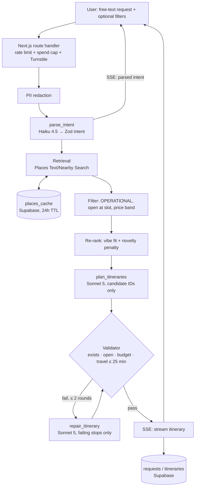

# Architecture

Status: design (pre-implementation). Build sequence added 2026-10-08. See [scope.md](scope.md) for targets and
[decision-log.md](decision-log.md) for why.

## Request flow

## Refinement agent

Rules: venue IDs must come from tool results; the final answer must pass `validate_itinerary`;
user text is treated as data.

## Shared components

| Component | Location | Used by |
|---|---|---|
| Itinerary validator (deterministic) | `src/validation/` | Pipeline, repair loop, agent tool, eval runner |
| Places client + cache + re-rank | `src/retrieval/` | Pipeline, agent `search_venues`, eval |
| Prompt loader (versioned files) | `prompts/` + `src/pipeline/` | All LLM stages |
| Model config / routing | `src/models/` | All LLM stages, eval model comparison |
| Tracing, redaction, cost | `src/monitoring/` | Everything |

## Data model (Supabase Postgres)

| Table | Key fields |
|---|---|
| `requests` | id, created_at, redacted_text, parsed_intent (jsonb), client_hash |
| `itineraries` | id, request_id, option_index, stops (jsonb), valid (bool), validation_errors (jsonb), prompt_versions, models, cost_usd, latency_ms |
| `feedback` | id, itinerary_id, thumbs, would_go, did_go, new_to_you (jsonb per venue), closed_report_place_id |
| `places_cache` | place_id / query_key, payload (terms-permitted fields), fetched_at, expires_at |
| `saved_plans` | id, user_id (magic link), itinerary_id, share_slug |

## Observability (Datadog)

One trace per request (or agent turn) in Datadog LLM Observability. Spans: `parse` → `places.search` (× N, cache hit/miss) →
`rerank` → `plan` → `validate` → `repair` (× ≤ 2) → `stream`. Tags: prompt versions, model IDs,
test-case ID (eval runs). Metadata: tokens, cost, latency, validation errors by type.
Eval runs push to Datadog datasets/experiments for version comparison.

## Deployment

Vercel (Next.js app + route handlers, preview per PR) · Supabase (Postgres + magic-link auth) ·
Upstash/Vercel KV (rate limits) · Datadog · GitHub Actions (typecheck, lint, tests,
eval smoke subset) · Dockerfile for local dev and the eval runner.

## Build sequence

Written 2026-10-08 from [scope.md](scope.md). The repo has these docs and no application code.
Scope marks the 2026-10-04 milestone done (60-case set, validator, filter-only baseline). Those
files are not in this workspace. Land them before treating the 2026-10-11 pipeline milestone as started.

Build in phase order. The validator, Places client, prompt loader, model router, and Datadog
wrapper are shared: the pipeline, repair loop, agent, and eval runner call the same ones.
`search_venues` uses the same retrieval path as the planner.

**Out of v1:** embeddings and a review-text store, fine-tuning, a dynamic model router,
friend-group mode. Opus 5 is an offline judge only. Anonymous use stays the default.

**Open decision:** the scope requires travel minutes and a ≤ 25 min check, and does not name
the source. Pick Routes, Distance Matrix, or a documented estimate, and record it in the
decision log before the validator is treated as final.

**Cut order if 2026-10-25 slips:** (1) model comparison reduced to 2 models; (2) route map;
(3) share links. The refinement agent stays.

### 1. Contracts

| # | Action | Lands in | Done when |
|---|---|---|---|
| 1 | Scaffold one Next.js app with the domain folders in scope §9. | `app/`, `src/`, `prompts/`, `evaluation/`, `tests/` | Strict TypeScript builds. Domain folders exist. |
| 2 | Define shared Zod schemas: intent, candidate, stop, itinerary, validation error, tool input. | `src/validation/` | Every boundary parses with Zod. An itinerary is 2–3 options of 2–4 timed stops, with no venue shared between options. |
| 3 | Move model IDs, cache TTL, rate limits, travel cap, and spend caps into config. | `src/models/`, `.env.example` | No key, model id, TTL, or threshold is hardcoded. |
| 4 | Create `requests`, `itineraries`, `feedback`, `places_cache`, `saved_plans`. | Supabase migration | Columns match the data model above. `places_cache` stores only fields Google's terms allow. |
| 5 | Redact names and other PII from free text before any database write or Datadog span. | `src/monitoring/` | A request containing a name is stored and traced only in redacted form. |

### 2. Shared kernel

Do this before prompt iteration. Later phases call these modules; they do not reimplement them.

| # | Action | Lands in | Done when |
|---|---|---|---|
| 6 | Build the deterministic validator: operational, open for the slot, within budget, travel ≤ 25 min. | `src/validation/` | The same function is callable from the pipeline, the repair loop, the agent tool, and the eval runner. |
| 7 | Choose how travel minutes are computed. | `src/validation/`, decision log | One method feeds the ≤ 25 min check. |
| 8 | Add versioned prompt files and a loader. Git stays the source of truth. | `prompts/*/v1.md`, loader in `src/pipeline/` | `parse_intent`, `plan_itineraries`, `repair_itinerary`, and `refine_agent` load from files. Each trace is tagged with prompt name and version. |
| 9 | Wire static routing: Haiku 4.5 for parse; Sonnet 5 for plan, repair, and the agent. | `src/models/` | Stage code asks the router for a model id. There is no dynamic router. |
| 10 | Open one Datadog LLM Observability trace per request, with a span per stage. | `src/monitoring/` | Spans cover parse, each Places call (cache hit or miss), re-rank, plan, validate, repair, and later agent turns. Metadata includes tokens, cost, latency, and validation errors by type. |

### 3. Retrieval — target 2026-10-11

| # | Action | Lands in | Done when |
|---|---|---|---|
| 11 | Call Places Text Search, Nearby Search, and Place Details. Venues come only from these responses. | `src/retrieval/` | A query returns Place IDs plus hours, price, coords, rating, review count, and business status. |
| 12 | Cache Places responses for 24 hours, keyed by place id and by query. | `places_cache` | A repeat query inside the TTL does not call Places. Expired rows are not served. |
| 13 | Filter to `OPERATIONAL` venues that are open for the slot and inside the price band, then re-rank. | `src/retrieval/` | Top-K per stop type prefers vibe-tag fit and penalizes very high review counts. Closed venues never reach the planner. |
| 14 | Retry a Places 429 or timeout once, then surface a partial result with a clear error. | `src/retrieval/` | The failure is a span with status error. The user is not shown an invented stop. |

### 4. Pipeline and eval — target 2026-10-11

| # | Action | Lands in | Done when |
|---|---|---|---|
| 15 | Orchestrate redact → parse → retrieve → plan → validate → repair. | `src/pipeline/` | Repair fixes only the failing stops, at most twice, then that option is dropped. |
| 16 | Hard-gate invented venues. Any Place ID absent from retrieval fails the case. | `src/pipeline/`, `src/validation/` | The pipeline cannot emit an unknown id, and the eval can compute invented-venue rate. |
| 17 | Stream with SSE: parsed intent first, then each itinerary only after it passes validation. | `app/` route handler | The client never receives an unvalidated stop. |
| 18 | Check in the frozen 60-case synthetic set. | `evaluation/` | Cases cover borough, budget ($50–$300), time, vibe, and edges (late Sunday, dietary, tight budget). v1 stays frozen; new failures go to v2. |
| 19 | Score validity, invented-venue rate, diversity/novelty, and format compliance. | `evaluation/` runner | One command prints the four metrics. Candidate recall is scored separately so a retrieval miss is not blamed on the planner. |
| 20 | Run both baselines on the same set: filter-only (no LLM) and raw ChatGPT/Claude (no retrieval). | `evaluation/` | The comparison table exists before a prompt version is called done. |
| 21 | CI on every PR: typecheck, lint, unit tests, and a small eval smoke subset. | `.github/workflows`, Dockerfile | A prompt change cannot merge without the smoke subset. Target 80% coverage on `src/`. |

### 5. API and UI — target 2026-10-18

| # | Action | Lands in | Done when |
|---|---|---|---|
| 22 | Cap anonymous use: 5 plans per hour per IP, plus a global daily spend cap. | Upstash or Vercel KV, `src/monitoring/` | Over the daily cap, the API returns a come-back-tomorrow response and stops calling models. |
| 23 | Require Turnstile on the first request. Keep API keys server-side. | `app/` route handler | A request with no captcha token is rejected. The browser never sees the Anthropic or Places key. |
| 24 | Persist the redacted request, parsed intent, options, validation result, prompt versions, model, cost, and latency. | `requests`, `itineraries` | A finished plan can be reloaded from Postgres without re-calling the model. |
| 25 | Build the request screen: free text plus optional date, budget, and neighborhood, then side-by-side stop timelines. | `app/` | A beta user can submit a request and see 2–3 streamed itineraries with a one-line why on each stop. |
| 26 | Collect thumbs, would-go, did-you-go, new-to-you, and closed-venue reports. | `feedback`, UI | Each signal is stored against the itinerary or place id and can be joined back to the Datadog trace. |
| 27 | Add the route map. Cut this second if the date slips. | Google Maps JS | Stops for the selected itinerary render on a map. |
| 28 | Add magic-link save and share. Cut this third if the date slips. | Supabase auth, `saved_plans` | An anonymous session can save a plan and open it from a share slug. |

### 6. Refinement agent — target 2026-10-18

Core v1. Do not cut this to make the date.

| # | Action | Lands in | Done when |
|---|---|---|---|
| 29 | Implement `search_venues`, `replace_stop`, `reorder_stops`, and `validate_itinerary`. | `src/agent/` | Each tool has a Zod contract and about four unit tests, including unknown-id rejection. Places errors return `is_error`. |
| 30 | Run the agent on Sonnet 5 with a hard stop at 6 tool calls and $0.03 per turn. | `src/agent/`, cost ledger | User text is treated as data. Venue ids must come from a tool result in this turn. Off-topic requests are refused. |
| 31 | Require `validate_itinerary` before the final answer. On failure, revert to the last valid itinerary and explain. | `src/agent/` | A turn cannot end on an invalid plan. The revert is counted in agent metrics. |
| 32 | Add the agent suite: 5 workflow tests, 5 adversarial tests, and 20 scripted edits. | `evaluation/` | The report includes completion rate, post-edit validity, average steps, and cost per turn. |

### 7. Observe and ship — target 2026-10-25

| # | Action | Lands in | Done when |
|---|---|---|---|
| 33 | Alert when daily spend passes 80% of the cap, and when the 1-hour error rate passes 10%. | Datadog monitors | Both monitors fire on a forced breach in a dry run. A weekly snapshot covers validity, p50/p99, and cost per request. |
| 34 | Push eval runs to Datadog datasets and experiments, tagged with prompt version and test-case id. | `evaluation/` runner | Two prompt versions can be compared in the dashboard. |
| 35 | Write the weekly error-analysis loop. | `docs/error-analysis.md` | Each review pulls invalid and repair-triggered traces from Datadog, joins thumbs-down from Supabase, tags the fixed taxonomy, and adds representative cases to v2. |
| 36 | Calibrate an offline Opus 5 judge on about 30 human labels, then run the model comparison. Shrink to 2 models first if the date slips. | `evaluation/` | Agreement is reported. Each stage keeps the cheapest model that holds ≥ 90% validity and fit within 5% of the best. Opus stays off the request path. |
| 37 | Run the beta, fold 20 real requests into frozen v1, and publish the README plus a live demo. | `README.md`, Vercel | The README links this doc, the decision log, eval results, and the demo. v1 is 80 cases and stays frozen. |
