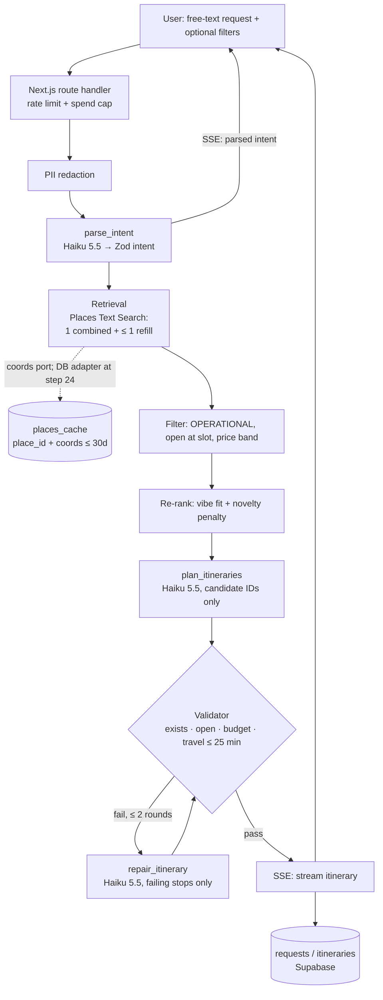
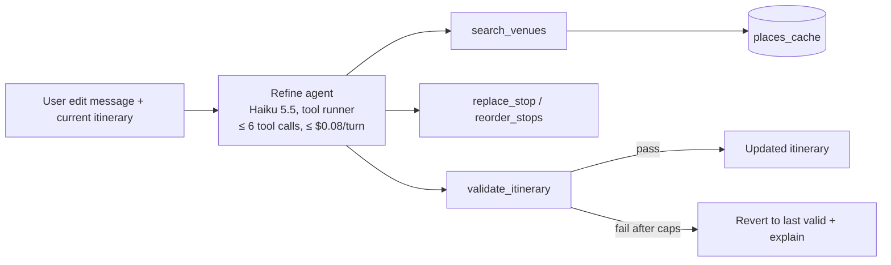

# Architecture

Status: design (pre-implementation). Build order: [build-sequence.md](build-sequence.md). See [scope.md](scope.md) for targets and
[decision-log.md](decision-log.md) for why.

## Request flow

## Refinement agent

Rules: venue IDs must come from tool results; the final answer must pass `validate_itinerary`;
user text is treated as data.

## Shared components

| Component | Location | Used by |
|---|---|---|
| Itinerary validator (deterministic) | `src/validation/` | Pipeline, repair loop, agent tool, eval runner |
| Places client + re-rank + coords-cache port (import via `src/retrieval/index.ts` only) | `src/retrieval/` | Pipeline, agent `search_venues`, eval |
| Prompt loader (versioned files) | `prompts/` + `src/pipeline/` | All LLM stages |
| Model config / routing | `src/models/` | All LLM stages, eval model comparison |
| Tracing, redaction, cost | `src/monitoring/` | Everything |

## Data model (Supabase Postgres)

| Table | Key fields |
|---|---|
| `requests` | id, created_at, redacted_text, parsed_intent (jsonb), client_hash |
| `itineraries` | id, request_id, option_index, stops (jsonb: `placeId` + planning fields only; no name/address/rating/hours), valid (bool), validation_errors (jsonb), prompt_versions, models, cost_usd, latency_ms |
| `feedback` | id, itinerary_id, thumbs, would_go, did_go, new_to_you (jsonb per venue), closed_report_place_id |
| `places_cache` | place_id (PK), lat, lng, coords_fetched_at, coords_expires_at (≤ 30d). No payload. Query-result cache dropped. |
| `saved_plans` | id, user_id (magic link), itinerary_id, share_slug |

## Observability (Datadog)

One trace per request (or agent turn) in Datadog LLM Observability. Spans: `parse` → `places.search` (× N, cache hit/miss) →
`rerank` → `plan` → `validate` → `repair` (× ≤ 2) → `stream`. Tags: prompt versions, model IDs,
test-case ID (eval runs). Metadata: tokens, cost, latency, validation errors by type.
Span tags and metadata carry an allowlisted `parsed_intent` summary (no `area`, `dietary`, or `vibeTags` text) plus an HMAC-SHA256 request hash (#27, #32).
Free text goes only to LLM Obs input and output (#42). `parse`, `plan`, and `repair` are `task` spans; dd-trace's Anthropic integration, the one plugin on, nests an `llm` span under each with the prompt, reply, tokens, cost, and Prompt Tracking id and version. The `request` workflow span's input is the redacted request and its output the emitted place ids and names. HTTP and fetch plugins stay off, so Places and Routes calls are never traced, and no API key or `REQUEST_HASH_SECRET` reaches a span.
Eval runs push to Datadog datasets/experiments for version comparison.

## Deployment

Vercel (Next.js app + route handlers, preview per PR) · Supabase (Postgres + magic-link auth) ·
Upstash/Vercel KV (rate limits) · Datadog · GitHub Actions (typecheck, lint, tests,
eval smoke subset) · Dockerfile for local dev and the eval runner.
